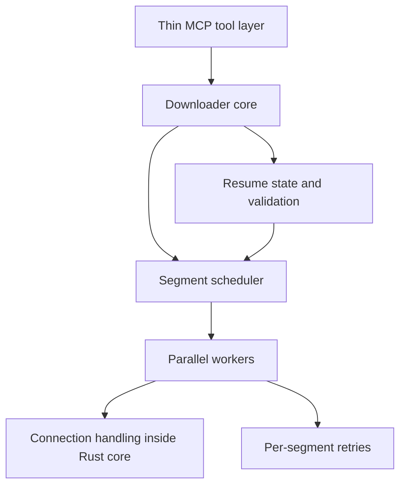

# Rust Downloader MCP Foundation

`mcp-tools` is a dependency-free Rust 2024 scaffold for a parallel downloader MCP
server. It currently provides shared data types and a binary that reports its
scaffold status to stderr. Downloading and MCP transport are not implemented.

## Setup and development

Use an installed Rust toolchain supporting edition 2024, with rustfmt and Clippy.
No toolchain file is pinned. From the repository root, run:

```sh
cargo build --offline
cargo fmt --check
cargo clippy --offline --all-targets -- -D warnings
cargo test --offline
cargo run --offline --quiet
```

`mise run rust-check` runs the same Rust checks. Use `mise run docs-check` for
Markdown or Mermaid changes, or `mise run check` for both sets of checks.

The binary exits successfully with `mcp-tools: downloader MCP scaffold only.` on
stderr and no stdout output. Future MCP integration must reserve stdout for
protocol messages. GitHub Actions runs formatting, Clippy, and tests on stable
Rust; hosted CI requires network access for checkout and toolchain setup.

Hosted CI remains **unverified** until a remote is configured, the code is pushed,
and GitHub Actions runs. Only local checks have passed.

## Mermaid documentation

The Mermaid CLI is a local documentation development dependency. Install its
browser runtime and render the embedded README diagram with:

```sh
mise exec -- npm ci
mise exec -- npm run docs:install-browser
mise exec -- npm run docs:check
```

Alternatively, run `mise run docs-check`, which runs all three commands. Choose
one approach; do not run the direct commands and the wrapper task together.

The rendered SVG is written under the ignored `target/mermaid/` directory.

## Current layout

```text
src/
  lib.rs          Library entry point and type re-exports
  downloader.rs   DownloadRequest, ByteRangeSegment, DownloadProgress
  main.rs         Stderr-only scaffold status
```

The types are plain data containers; request and range validation are not yet
implemented. Byte ranges use `[start, end)` semantics: start-inclusive,
end-exclusive. Progress can represent an unknown total size.

## Intended architecture

Reconstructed from the architecture document's prose.



This depicts planned responsibilities, not implemented modules or the original
diagram. The supplied `Rust Parallel Downloader MCP Core Architecture.md` remains
the reference; its embedded diagram is unavailable in the Markdown file.

## Roadmap

1. **Basic download:** implement a single download with request validation,
   connection handling, file output, and meaningful progress.
2. **Parallel segments:** introduce scheduling and workers with validated byte
   ranges and handling for servers that do not support range requests.
3. **Retries:** add bounded per-segment retries and failure reporting.
4. **Validated resume:** choose a persistent state format and validate the remote
   file and local partial data before resuming.
5. **MCP integration:** expose downloader operations through a thin tool layer,
   keeping diagnostics on stderr.

Add subsystem modules and behavior tests as these stages are implemented.
